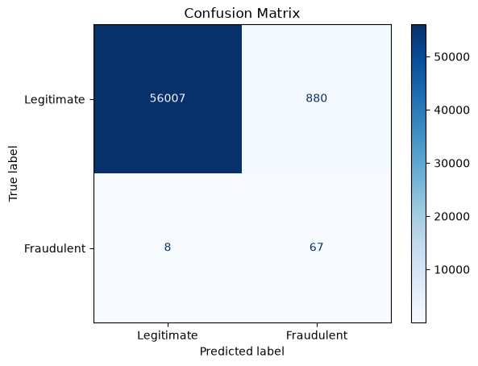
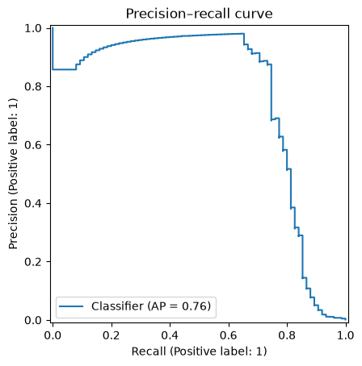

# Credit card fraud detection

## Objective:
To build a simple model that can identify fradulent credit card transactions.

## Dataset:
The dataset was downloaded from Kaggle (https://www.kaggle.com/datasets/mlg-ulb/creditcardfraud/data?select=creditcard.csv). It contains numerical PCA-transformed features, transaction amount, elapsed transaction time, and a fraud label.

- Class 0: legitimate transaction
- Class 1: fraudulent transaction

## Approach
This code will explore the data, train a model using logistic regression, and evaluate its precision, recall, and mistakes.

# Import the required libraries, and load the data:


```python
import pandas as pd
import matplotlib.pyplot as plt
import sklearn

df = pd.read_csv("creditcard.csv")

df.head()
```


<div>
<style scoped>
    .dataframe tbody tr th:only-of-type {
        vertical-align: middle;
    }

    .dataframe tbody tr th {
        vertical-align: top;
    }

    .dataframe thead th {
        text-align: right;
    }
</style>
<table border="1" class="dataframe">
  <thead>
    <tr style="text-align: right;">
      <th></th>
      <th>Time</th>
      <th>V1</th>
      <th>V2</th>
      <th>V3</th>
      <th>V4</th>
      <th>V5</th>
      <th>V6</th>
      <th>V7</th>
      <th>V8</th>
      <th>V9</th>
      <th>...</th>
      <th>V21</th>
      <th>V22</th>
      <th>V23</th>
      <th>V24</th>
      <th>V25</th>
      <th>V26</th>
      <th>V27</th>
      <th>V28</th>
      <th>Amount</th>
      <th>Class</th>
    </tr>
  </thead>
  <tbody>
    <tr>
      <th>0</th>
      <td>0.0</td>
      <td>-1.359807</td>
      <td>-0.072781</td>
      <td>2.536347</td>
      <td>1.378155</td>
      <td>-0.338321</td>
      <td>0.462388</td>
      <td>0.239599</td>
      <td>0.098698</td>
      <td>0.363787</td>
      <td>...</td>
      <td>-0.018307</td>
      <td>0.277838</td>
      <td>-0.110474</td>
      <td>0.066928</td>
      <td>0.128539</td>
      <td>-0.189115</td>
      <td>0.133558</td>
      <td>-0.021053</td>
      <td>149.62</td>
      <td>0</td>
    </tr>
    <tr>
      <th>1</th>
      <td>0.0</td>
      <td>1.191857</td>
      <td>0.266151</td>
      <td>0.166480</td>
      <td>0.448154</td>
      <td>0.060018</td>
      <td>-0.082361</td>
      <td>-0.078803</td>
      <td>0.085102</td>
      <td>-0.255425</td>
      <td>...</td>
      <td>-0.225775</td>
      <td>-0.638672</td>
      <td>0.101288</td>
      <td>-0.339846</td>
      <td>0.167170</td>
      <td>0.125895</td>
      <td>-0.008983</td>
      <td>0.014724</td>
      <td>2.69</td>
      <td>0</td>
    </tr>
    <tr>
      <th>2</th>
      <td>1.0</td>
      <td>-1.358354</td>
      <td>-1.340163</td>
      <td>1.773209</td>
      <td>0.379780</td>
      <td>-0.503198</td>
      <td>1.800499</td>
      <td>0.791461</td>
      <td>0.247676</td>
      <td>-1.514654</td>
      <td>...</td>
      <td>0.247998</td>
      <td>0.771679</td>
      <td>0.909412</td>
      <td>-0.689281</td>
      <td>-0.327642</td>
      <td>-0.139097</td>
      <td>-0.055353</td>
      <td>-0.059752</td>
      <td>378.66</td>
      <td>0</td>
    </tr>
    <tr>
      <th>3</th>
      <td>1.0</td>
      <td>-0.966272</td>
      <td>-0.185226</td>
      <td>1.792993</td>
      <td>-0.863291</td>
      <td>-0.010309</td>
      <td>1.247203</td>
      <td>0.237609</td>
      <td>0.377436</td>
      <td>-1.387024</td>
      <td>...</td>
      <td>-0.108300</td>
      <td>0.005274</td>
      <td>-0.190321</td>
      <td>-1.175575</td>
      <td>0.647376</td>
      <td>-0.221929</td>
      <td>0.062723</td>
      <td>0.061458</td>
      <td>123.50</td>
      <td>0</td>
    </tr>
    <tr>
      <th>4</th>
      <td>2.0</td>
      <td>-1.158233</td>
      <td>0.877737</td>
      <td>1.548718</td>
      <td>0.403034</td>
      <td>-0.407193</td>
      <td>0.095921</td>
      <td>0.592941</td>
      <td>-0.270533</td>
      <td>0.817739</td>
      <td>...</td>
      <td>-0.009431</td>
      <td>0.798278</td>
      <td>-0.137458</td>
      <td>0.141267</td>
      <td>-0.206010</td>
      <td>0.502292</td>
      <td>0.219422</td>
      <td>0.215153</td>
      <td>69.99</td>
      <td>0</td>
    </tr>
  </tbody>
</table>
<p>5 rows × 31 columns</p>
</div>


# Inspect the data:


```python
# Number of rows and columns in the dataset:
print("Number of rows and columns in the dataset:", df.shape)

# Total number of missing values in the dataset:
print("Total number of missing values in the dataset:", df.isnull().sum().sum())

# Total number of duplicate rows in the dataset:
print("Total number of duplicate rows in the dataset:", df.duplicated().sum())
```

    Number of rows and columns in the dataset: (284807, 31)
    Total number of missing values in the dataset: 0
    Total number of duplicate rows in the dataset: 1081


# Exploratory data analysis (EDA):


```python
# How common is fraud in the dataset?
counts = df['Class'].value_counts().sort_index()


summary = pd.DataFrame({'Class': counts.index, 
                        'Count': counts.values,
                        'Percentage (%)': (counts.values / len(df)) * 100
})


summary.index = ["Legitimate", "Fraudulent"]

summary.round(3)

```


<div>
<style scoped>
    .dataframe tbody tr th:only-of-type {
        vertical-align: middle;
    }

    .dataframe tbody tr th {
        vertical-align: top;
    }

    .dataframe thead th {
        text-align: right;
    }
</style>
<table border="1" class="dataframe">
  <thead>
    <tr style="text-align: right;">
      <th></th>
      <th>Class</th>
      <th>Count</th>
      <th>Percentage (%)</th>
    </tr>
  </thead>
  <tbody>
    <tr>
      <th>Legitimate</th>
      <td>0</td>
      <td>284315</td>
      <td>99.827</td>
    </tr>
    <tr>
      <th>Fraudulent</th>
      <td>1</td>
      <td>492</td>
      <td>0.173</td>
    </tr>
  </tbody>
</table>
</div>


# Plot the counts:


```python
counts.plot.bar(color=["steelblue", "tomato"])

plt.xticks([0, 1], ["Legitimate", "Fraudulent"], rotation=0)
plt.ylabel("Number of transactions")
plt.title("Distribution of Legitimate and Fraudulent Transactions")
plt.show()
```


    

    


### Key Observation:
Fraudulent transactions represent only 0.17% of the total transactions in our dataset. Therefore, a high overall accuracy alone wouldn't demonstrate that the model can detect fradulent transactions.

# How do transaction amounts differ?


```python
df.groupby("Class")["Amount"].agg(["count", "mean", "std", "median", "min", "max"]).round(2)
```


<div>
<style scoped>
    .dataframe tbody tr th:only-of-type {
        vertical-align: middle;
    }

    .dataframe tbody tr th {
        vertical-align: top;
    }

    .dataframe thead th {
        text-align: right;
    }
</style>
<table border="1" class="dataframe">
  <thead>
    <tr style="text-align: right;">
      <th></th>
      <th>count</th>
      <th>mean</th>
      <th>std</th>
      <th>median</th>
      <th>min</th>
      <th>max</th>
    </tr>
    <tr>
      <th>Class</th>
      <th></th>
      <th></th>
      <th></th>
      <th></th>
      <th></th>
      <th></th>
    </tr>
  </thead>
  <tbody>
    <tr>
      <th>0</th>
      <td>284315</td>
      <td>88.29</td>
      <td>250.11</td>
      <td>22.00</td>
      <td>0.0</td>
      <td>25691.16</td>
    </tr>
    <tr>
      <th>1</th>
      <td>492</td>
      <td>122.21</td>
      <td>256.68</td>
      <td>9.25</td>
      <td>0.0</td>
      <td>2125.87</td>
    </tr>
  </tbody>
</table>
</div>


```python
df.boxplot(column="Amount", by="Class", grid=False, showfliers=False)

plt.xticks([1, 2], ["Legitimate", "Fraudulent"], rotation=0)
plt.xlabel("Transaction Class")
plt.ylabel("Transaction Amount")
plt.title("Boxplot of transaction amounts by class")
plt.suptitle("")
plt.show()
```


    

    


### NOTE: For improved readability, extreme values have been hidden in the above figure, not removed from the dataset.

# Train a model:


```python
# Import the necessary libraries for model training and evaluation:
from sklearn.pipeline import make_pipeline
from sklearn.preprocessing import StandardScaler
from sklearn.linear_model import LogisticRegression


df = df.sort_values("Time").reset_index(drop=True)

# Keep transactions with the same timestamp together:
cutoff = df["Time"].iloc[int(len(df) * 0.8)]

# Split the dataset into training and testing sets based on the cutoff timestamp:
train = df[df["Time"] < cutoff]
test = df[df["Time"] >= cutoff]

x_train = train.drop(columns="Class")
y_train = train["Class"]

x_test = test.drop(columns="Class")
y_test = test["Class"]

# Create a pipeline that standardizes the features and trains a logistic regression model with balanced class weights:
model = make_pipeline(
    StandardScaler(),
    LogisticRegression(class_weight="balanced", max_iter=2000)
)

model.fit(x_train, y_train)

```


<style>.sk-global {
  /* Definition of color scheme common for light and dark mode */
  --sklearn-color-text: #000;
  --sklearn-color-text-muted: #666;
  --sklearn-color-line: gray;
  /* Definition of color scheme for unfitted estimators */
  --sklearn-color-unfitted-level-0: #fff5e6;
  --sklearn-color-unfitted-level-1: #f6e4d2;
  --sklearn-color-unfitted-level-2: #ffe0b3;
  --sklearn-color-unfitted-level-3: chocolate;
  /* Definition of color scheme for fitted estimators */
  --sklearn-color-fitted-level-0: #f0f8ff;
  --sklearn-color-fitted-level-1: #d4ebff;
  --sklearn-color-fitted-level-2: #b3dbfd;
  --sklearn-color-fitted-level-3: cornflowerblue;
}

.sk-global.light {
  /* Specific color for light theme */
  --sklearn-color-text-on-default-background: black;
  --sklearn-color-background: white;
  --sklearn-color-border-box: black;
  --sklearn-color-icon: #696969;
}

.sk-global.dark {
  --sklearn-color-text-on-default-background: white;
  --sklearn-color-background: #111;
  --sklearn-color-border-box: white;
  --sklearn-color-icon: #878787;
}

.sk-global {
  color: var(--sklearn-color-text);
}

.sk-global pre {
  padding: 0;
}

.sk-global input.sk-hidden--visually {
  border: 0;
  clip-path: inset(100%);
  height: 1px;
  margin: -1px;
  overflow: hidden;
  padding: 0;
  position: absolute;
  width: 1px;
}

.sk-global div.sk-dashed-wrapped {
  border: 1px dashed var(--sklearn-color-line);
  margin: 0 0.4em 0.5em 0.4em;
  box-sizing: border-box;
  padding-bottom: 0.4em;
  background-color: var(--sklearn-color-background);
}

.sk-global div.sk-container {
  /* jupyter's `normalize.less` sets `[hidden] { display: none; }`
     but bootstrap.min.css set `[hidden] { display: none !important; }`
     so we also need the `!important` here to be able to override the
     default hidden behavior on the sphinx rendered scikit-learn.org.
     See: https://github.com/scikit-learn/scikit-learn/issues/21755 */
  display: inline-block !important;
  position: relative;
}

.sk-global div.sk-text-repr-fallback {
  display: none;
}

div.sk-parallel-item,
div.sk-serial,
div.sk-item {
  /* draw centered vertical line to link estimators */
  background-image: linear-gradient(var(--sklearn-color-text-on-default-background), var(--sklearn-color-text-on-default-background));
  background-size: 2px 100%;
  background-repeat: no-repeat;
  background-position: center center;
}

/* Parallel-specific style estimator block */

.sk-global div.sk-parallel-item::after {
  content: "";
  width: 100%;
  border-bottom: 2px solid var(--sklearn-color-text-on-default-background);
  flex-grow: 1;
}

.sk-global div.sk-parallel {
  display: flex;
  align-items: stretch;
  justify-content: center;
  background-color: var(--sklearn-color-background);
  position: relative;
}

.sk-global div.sk-parallel-item {
  display: flex;
  flex-direction: column;
}

.sk-global div.sk-parallel-item:first-child::after {
  align-self: flex-end;
  width: 50%;
}

.sk-global div.sk-parallel-item:last-child::after {
  align-self: flex-start;
  width: 50%;
}

.sk-global div.sk-parallel-item:only-child::after {
  width: 0;
}

/* Serial-specific style estimator block */

.sk-global div.sk-serial {
  display: flex;
  flex-direction: column;
  align-items: center;
  background-color: var(--sklearn-color-background);
  padding-right: 1em;
  padding-left: 1em;
}


/* Toggleable style: style used for estimator/Pipeline/ColumnTransformer box that is
clickable and can be expanded/collapsed.
- Pipeline and ColumnTransformer use this feature and define the default style
- Estimators will overwrite some part of the style using the `sk-estimator` class
*/

/* Pipeline and ColumnTransformer style (default) */

.sk-global div.sk-toggleable {
  /* Default theme specific background. It is overwritten whether we have a
  specific estimator or a Pipeline/ColumnTransformer */
  background-color: var(--sklearn-color-background);
}

/* Toggleable label */
.sk-global label.sk-toggleable__label {
  cursor: pointer;
  display: flex;
  width: 100%;
  margin-bottom: 0;
  padding: 0.5em;
  box-sizing: border-box;
  text-align: center;
  align-items: center;
  justify-content: center;
  gap: 0.5em;
}

.sk-global label.sk-toggleable__label .caption {
  font-size: 0.6rem;
  font-weight: lighter;
  color: var(--sklearn-color-text-muted);
}

.sk-global label.sk-toggleable__label-arrow:before {
  /* Arrow on the left of the label */
  content: "▸";
  float: left;
  margin-right: 0.25em;
  color: var(--sklearn-color-icon);
}

.sk-global label.sk-toggleable__label-arrow:hover:before {
  color: var(--sklearn-color-text);
}

/* Toggleable content - dropdown */

.sk-global div.sk-toggleable__content {
  display: none;
  text-align: left;
  /* unfitted */
  background-color: var(--sklearn-color-unfitted-level-0);
}

.sk-global div.sk-toggleable__content.fitted {
  /* fitted */
  background-color: var(--sklearn-color-fitted-level-0);
}

.sk-global div.sk-toggleable__content pre {
  margin: 0.2em;
  border-radius: 0.25em;
  color: var(--sklearn-color-text);
  /* unfitted */
  background-color: var(--sklearn-color-unfitted-level-0);
}

.sk-global div.sk-toggleable__content.fitted pre {
  /* unfitted */
  background-color: var(--sklearn-color-fitted-level-0);
}

.sk-global input.sk-toggleable__control:checked~div.sk-toggleable__content {
  /* Expand drop-down */
  display: block;
  width: 100%;
  overflow: visible;
}

.sk-global input.sk-toggleable__control:checked~label.sk-toggleable__label-arrow:before {
  content: "▾";
}

/* Pipeline/ColumnTransformer-specific style */

.sk-global div.sk-label input.sk-toggleable__control:checked~label.sk-toggleable__label {
  color: var(--sklearn-color-text);
  background-color: var(--sklearn-color-unfitted-level-2);
}

.sk-global div.sk-label.fitted input.sk-toggleable__control:checked~label.sk-toggleable__label {
  background-color: var(--sklearn-color-fitted-level-2);
}

/* Estimator-specific style */

/* Colorize estimator box */
.sk-global div.sk-estimator input.sk-toggleable__control:checked~label.sk-toggleable__label {
  /* unfitted */
  background-color: var(--sklearn-color-unfitted-level-2);
}

.sk-global div.sk-estimator.fitted input.sk-toggleable__control:checked~label.sk-toggleable__label {
  /* fitted */
  background-color: var(--sklearn-color-fitted-level-2);
}

.sk-global div.sk-label label.sk-toggleable__label,
.sk-global div.sk-label label {
  /* The background is the default theme color */
  color: var(--sklearn-color-text-on-default-background);
}

/* On hover, darken the color of the background */
.sk-global div.sk-label:hover label.sk-toggleable__label {
  color: var(--sklearn-color-text);
  background-color: var(--sklearn-color-unfitted-level-2);
}

/* Label box, darken color on hover, fitted */
.sk-global div.sk-label.fitted:hover label.sk-toggleable__label.fitted {
  color: var(--sklearn-color-text);
  background-color: var(--sklearn-color-fitted-level-2);
}

/* Estimator label */

.sk-global div.sk-label label {
  font-family: monospace;
  font-weight: bold;
  line-height: 1.2em;
}

.sk-global div.sk-label-container {
  text-align: center;
}

/* Estimator-specific */
.sk-global div.sk-estimator {
  font-family: monospace;
  border: 1px dotted var(--sklearn-color-border-box);
  border-radius: 0.25em;
  box-sizing: border-box;
  margin-bottom: 0.5em;
  /* unfitted */
  background-color: var(--sklearn-color-unfitted-level-0);
}

.sk-global div.sk-estimator.fitted {
  /* fitted */
  background-color: var(--sklearn-color-fitted-level-0);
}

/* on hover */
.sk-global div.sk-estimator:hover {
  /* unfitted */
  background-color: var(--sklearn-color-unfitted-level-2);
}

.sk-global div.sk-estimator.fitted:hover {
  /* fitted */
  background-color: var(--sklearn-color-fitted-level-2);
}

/* Specification for estimator info (e.g. "i" and "?") */

/* Common style for "i" and "?" */

.sk-estimator-doc-link,
a:link.sk-estimator-doc-link,
a:visited.sk-estimator-doc-link {
  float: right;
  font-size: smaller;
  line-height: 1em;
  font-family: monospace;
  background-color: var(--sklearn-color-unfitted-level-0);
  border-radius: 1em;
  height: 1em;
  width: 1em;
  text-decoration: none !important;
  margin-left: 0.5em;
  text-align: center;
  /* unfitted */
  border: var(--sklearn-color-unfitted-level-3) 1pt solid;
  color: var(--sklearn-color-unfitted-level-3);
}

.sk-estimator-doc-link.fitted,
a:link.sk-estimator-doc-link.fitted,
a:visited.sk-estimator-doc-link.fitted {
  /* fitted */
  background-color: var(--sklearn-color-fitted-level-0);
  border: var(--sklearn-color-fitted-level-3) 1pt solid;
  color: var(--sklearn-color-fitted-level-3);
}

/* On hover */
div.sk-estimator:hover .sk-estimator-doc-link:hover,
.sk-estimator-doc-link:hover,
div.sk-label-container:hover .sk-estimator-doc-link:hover,
.sk-estimator-doc-link:hover {
  /* unfitted */
  background-color: var(--sklearn-color-unfitted-level-3);
  border: var(--sklearn-color-fitted-level-0) 1pt solid;
  color: var(--sklearn-color-unfitted-level-0);
  text-decoration: none;
}

div.sk-estimator.fitted:hover .sk-estimator-doc-link.fitted:hover,
.sk-estimator-doc-link.fitted:hover,
div.sk-label-container:hover .sk-estimator-doc-link.fitted:hover,
.sk-estimator-doc-link.fitted:hover {
  /* fitted */
  background-color: var(--sklearn-color-fitted-level-3);
  border: var(--sklearn-color-fitted-level-0) 1pt solid;
  color: var(--sklearn-color-fitted-level-0);
  text-decoration: none;
}

/* Span, style for the box shown on hovering the info icon */
.sk-estimator-doc-link span {
  display: none;
  z-index: 9999;
  position: relative;
  font-weight: normal;
  right: .2ex;
  padding: .5ex;
  margin: .5ex;
  width: min-content;
  min-width: 20ex;
  max-width: 50ex;
  color: var(--sklearn-color-text);
  box-shadow: 2pt 2pt 4pt #999;
  /* unfitted */
  background: var(--sklearn-color-unfitted-level-0);
  border: .5pt solid var(--sklearn-color-unfitted-level-3);
}

.sk-estimator-doc-link.fitted span {
  /* fitted */
  background: var(--sklearn-color-fitted-level-0);
  border: var(--sklearn-color-fitted-level-3);
}

.sk-estimator-doc-link:hover span {
  display: block;
}

/* "?"-specific style due to the `<a>` HTML tag */

.sk-global a.estimator_doc_link {
  float: right;
  font-size: 1rem;
  line-height: 1em;
  font-family: monospace;
  background-color: var(--sklearn-color-unfitted-level-0);
  border-radius: 1rem;
  height: 1rem;
  width: 1rem;
  text-decoration: none;
  /* unfitted */
  color: var(--sklearn-color-unfitted-level-1);
  border: var(--sklearn-color-unfitted-level-1) 1pt solid;
}

.sk-global a.estimator_doc_link.fitted {
  /* fitted */
  background-color: var(--sklearn-color-fitted-level-0);
  border: var(--sklearn-color-fitted-level-1) 1pt solid;
  color: var(--sklearn-color-fitted-level-1);
}

/* On hover */
.sk-global a.estimator_doc_link:hover {
  /* unfitted */
  background-color: var(--sklearn-color-unfitted-level-3);
  color: var(--sklearn-color-background);
  text-decoration: none;
}

.sk-global a.estimator_doc_link.fitted:hover {
  /* fitted */
  background-color: var(--sklearn-color-fitted-level-3);
}

.sk-top-container.sk-global {
  /* pydata-sphinx-theme hides overflow, so scrolling is disabled.
   We need to set it to !important and add tabindex="0" in the HTML
   to allow keyboard-only users to navigate the display. */
  overflow-x: scroll !important;
  max-width: 100%;
}

.estimator-table {
    font-family: monospace;
}

.estimator-table summary {
    padding: .5rem;
    cursor: pointer;
}

.estimator-table summary::marker {
    font-size: 0.7rem;
}

.estimator-table details[open] {
    padding-left: 0.1rem;
    padding-right: 0.1rem;
    padding-bottom: 0.3rem;
}

.estimator-table .parameters-table {
    margin-left: auto !important;
    margin-right: auto !important;
    margin-top: 0;
}

.estimator-table .parameters-table tr:nth-child(odd) {
    background-color: #fff;
}

.estimator-table .parameters-table tr:nth-child(even) {
    background-color: #f6f6f6;
}

.estimator-table .parameters-table tr:hover td {
    background-color: #e0e0e0;
}

.estimator-table table :is(td, th) {
    border: 1px solid rgba(106, 105, 104, 0.232);
}

/*
    `table td`is set in notebook with right text-align.
    We need to overwrite it.
*/
.estimator-table table td.param {
    text-align: left;
    position: relative;
    padding: 0;
}

.user-set td {
    color:rgb(255, 94, 0);
    text-align: left !important;
}

.user-set td.value {
    color:rgb(255, 94, 0);
    background-color: transparent;
}

.default td, .estimator-table th {
    color: black;
    text-align: left !important;
}

.user-set td i,
.default td i {
    color: black;
}

td.fitted-att-type {
    white-space: preserve nowrap;
}

/*
    Styles for parameter documentation links
    We need styling for visited so jupyter doesn't overwrite it
*/
a.param-doc-link,
a.param-doc-link:link,
a.param-doc-link:visited {
    text-decoration: underline dashed;
    text-underline-offset: .3em;
    color: inherit;
    display: block;
    padding: .5em;
}

@supports(anchor-name: --doc-link) {
    a.param-doc-link,
    a.param-doc-link:link,
    a.param-doc-link:visited {
    anchor-name: --doc-link;
    }
}

/* "hack" to make the entire area of the cell containing the link clickable */
a.param-doc-link::before {
    position: absolute;
    content: "";
    inset: 0;
}

.param-doc-description {
    display: none;
    position: absolute;
    z-index: 9999;
    left: 0;
    padding: .5ex;
    margin-left: 1.5em;
    color: var(--sklearn-color-text);
    box-shadow: .3em .3em .4em #999;
    width: max-content;
    text-align: left;
    max-height: 10em;
    overflow-y: auto;

    /* unfitted */
    background: var(--sklearn-color-unfitted-level-0);
    border: thin solid var(--sklearn-color-unfitted-level-3);
}

@supports(position-area: center right) {
    .param-doc-description {
    position-area: center right;
    position: fixed;
    margin-left: 0;
    }
}

/* Fitted state for parameter tooltips */
.fitted .param-doc-description {
    /* fitted */
    background: var(--sklearn-color-fitted-level-0);
    border: thin solid var(--sklearn-color-fitted-level-3);
}

.param-doc-link:hover .param-doc-description {
    display: block;
}

.copy-paste-icon {
    background-image: url();
    background-repeat: no-repeat;
    background-size: 14px 14px;
    background-position: 0;
    display: inline-block;
    width: 14px;
    height: 14px;
    cursor: pointer;
    border: none;
    padding: 0;
    background-color: transparent;
}

.copy-paste-icon:focus-visible {
    outline: 1px solid currentColor;
    outline-offset: 1px;
}

.features {
  font-family: monospace;
  cursor: pointer;
  background-color: var(--sklearn-color-unfitted-level-0);
  border: 1px dotted var(--sklearn-color-border-box);
  border-radius: .20em;
  margin-bottom: 0.5em;
  font-size: inherit; /* Needed for jupyter */
}

.features.fitted {
  background-color: var(--sklearn-color-fitted-level-0);
}

.features summary {
  cursor: pointer;
  display: flex;
  margin-bottom: 0;
  text-align: center;
  align-items: center;
  justify-content: center;
  gap: 0.5em;
  padding: .25em;
}

.features details[open] > summary {
  color: var(--sklearn-color-text);
  background-color: var(--sklearn-color-unfitted-level-2);
  border-radius: .20em 0 0 0;
}

.features.fitted details[open] > summary {
  background-color: var(--sklearn-color-fitted-level-2);
  border-radius: .20em 0 0 0;
}

.features details > summary .arrow::before {
  content: "▸";
  color: grey;
}

.features details[open] > summary .arrow::before {
  content: "▾";
}

.features details:hover > summary {
  margin: 0;
  background-color: var(--sklearn-color-unfitted-level-2);
}

.features.fitted details:hover > summary {
  margin: 0;
  background-color: var(--sklearn-color-fitted-level-2);
}

.features .features-container {
  max-height: 10em;
  overflow: auto;
  scrollbar-width: thin;
  padding: .25em 0.1rem;
  background-color: var(--sklearn-color-unfitted-level-0);
  border-radius: 0 0 .5em .5em;
}

.features.fitted .features-container {
  background-color: var(--sklearn-color-fitted-level-0);
}

.features .image-container {
  block-size: 1em;
  inline-size: 1em;
  padding: 0;
  margin: 0%;
  display: flex;
  justify-content: center;
  align-items: center;
}

.features .copy-paste-icon {
  background-size: 1em 1em;
  width: 1em;
  height: 1em;
  filter: grayscale(100%) opacity(60%);
}

.features .features-container table {
  width: 100%;
  margin: 0.01em;
}

.features .features-container table tr:nth-child(odd) {
  background-color: #fff;
}

.features .features-container table tr:nth-child(even) {
  background-color: #f6f6f6;
}

.features .features-container table tr:hover {
  background-color: #e0e0e0;
}

.features .features-container table {
  table-layout: inherit;
}

.features .features-container table td {
  text-align: left;
  padding: 0 0.5em;
  border: 1px solid rgba(106, 105, 104, 0.232);
  white-space: nowrap;
  color: var(--sklearn-color-text);
}

.total_features {
  display: flex;
  justify-content: center;
  margin-top: 0.5em;
}
</style><body><div id="sk-container-id-1" tabindex="0" class="sk-top-container sk-global"><div class="sk-text-repr-fallback"><pre>Pipeline(steps=[(&#x27;standardscaler&#x27;, StandardScaler()),
                (&#x27;logisticregression&#x27;,
                 LogisticRegression(class_weight=&#x27;balanced&#x27;, max_iter=2000))])</pre><b>In a Jupyter environment, please rerun this cell to show the HTML representation or trust the notebook. <br />On GitHub, the HTML representation is unable to render, please try loading this page with nbviewer.org.</b></div><div class="sk-container" hidden><div class="sk-item sk-dashed-wrapped"><div class="sk-label-container"><div class="sk-label fitted sk-toggleable"><input class="sk-toggleable__control sk-hidden--visually sk-global" id="sk-estimator-id-1" type="checkbox" ><label for="sk-estimator-id-1" class="sk-toggleable__label fitted sk-toggleable__label-arrow"><div><div>Pipeline</div></div><div><a class="sk-estimator-doc-link fitted" rel="noreferrer" target="_blank" href="https://scikit-learn.org/1.9/modules/generated/sklearn.pipeline.Pipeline.html">?<span>Documentation for Pipeline</span></a><span class="sk-estimator-doc-link fitted">i<span>Fitted</span></span></div></label><div class="sk-toggleable__content fitted" data-param-prefix="">
        <div class="estimator-table">
            <details>
                <summary>Parameters</summary>
                <table class="parameters-table">
                  <tbody>

        <tr class="user-set">
            <td><button type="button" class="copy-paste-icon"
                 aria-label="Copy steps to clipboard"
                 onclick="copyToClipboard('steps',
                          this.parentElement.nextElementSibling)"
            ></button></td>
            <td class="param">
        <a class="param-doc-link"
            style="anchor-name: --doc-link-steps;"
            rel="noreferrer" target="_blank" href="https://scikit-learn.org/1.9/modules/generated/sklearn.pipeline.Pipeline.html#:~:text=steps,-list%20of%20tuples">
            steps
            <span class="param-doc-description"
            style="position-anchor: --doc-link-steps;">
            steps: list of tuples<br><br>List of (name of step, estimator) tuples that are to be chained in<br>sequential order. To be compatible with the scikit-learn API, all steps<br>must define `fit`. All non-last steps must also define `transform`. See<br>:ref:`Combining Estimators &lt;combining_estimators&gt;` for more details.</span>
        </a>
    </td>
            <td class="value">[(&#x27;standardscaler&#x27;, ...), (&#x27;logisticregression&#x27;, ...)]</td>
        </tr>


        <tr class="default">
            <td><button type="button" class="copy-paste-icon"
                 aria-label="Copy transform_input to clipboard"
                 onclick="copyToClipboard('transform_input',
                          this.parentElement.nextElementSibling)"
            ></button></td>
            <td class="param">
        <a class="param-doc-link"
            style="anchor-name: --doc-link-transform_input;"
            rel="noreferrer" target="_blank" href="https://scikit-learn.org/1.9/modules/generated/sklearn.pipeline.Pipeline.html#:~:text=transform_input,-list%20of%20str%2C%20default%3DNone">
            transform_input
            <span class="param-doc-description"
            style="position-anchor: --doc-link-transform_input;">
            transform_input: list of str, default=None<br><br>The names of the :term:`metadata` parameters that should be transformed by the<br>pipeline before passing it to the step consuming it.<br><br>This enables transforming some input arguments to ``fit`` (other than ``X``)<br>to be transformed by the steps of the pipeline up to the step which requires<br>them. Requirement is defined via :ref:`metadata routing &lt;metadata_routing&gt;`.<br>For instance, this can be used to pass a validation set through the pipeline.<br><br>You can only set this if metadata routing is enabled, which you<br>can enable using ``sklearn.set_config(enable_metadata_routing=True)``.<br><br>.. versionadded:: 1.6</span>
        </a>
    </td>
            <td class="value">None</td>
        </tr>


        <tr class="default">
            <td><button type="button" class="copy-paste-icon"
                 aria-label="Copy memory to clipboard"
                 onclick="copyToClipboard('memory',
                          this.parentElement.nextElementSibling)"
            ></button></td>
            <td class="param">
        <a class="param-doc-link"
            style="anchor-name: --doc-link-memory;"
            rel="noreferrer" target="_blank" href="https://scikit-learn.org/1.9/modules/generated/sklearn.pipeline.Pipeline.html#:~:text=memory,-str%20or%20object%20with%20the%20joblib.Memory%20interface%2C%20default%3DNone">
            memory
            <span class="param-doc-description"
            style="position-anchor: --doc-link-memory;">
            memory: str or object with the joblib.Memory interface, default=None<br><br>Used to cache the fitted transformers of the pipeline. The last step<br>will never be cached, even if it is a transformer. By default, no<br>caching is performed. If a string is given, it is the path to the<br>caching directory. Enabling caching triggers a clone of the transformers<br>before fitting. Therefore, the transformer instance given to the<br>pipeline cannot be inspected directly. Use the attribute ``named_steps``<br>or ``steps`` to inspect estimators within the pipeline. Caching the<br>transformers is advantageous when fitting is time consuming. See<br>:ref:`sphx_glr_auto_examples_neighbors_plot_caching_nearest_neighbors.py`<br>for an example on how to enable caching.</span>
        </a>
    </td>
            <td class="value">None</td>
        </tr>


        <tr class="default">
            <td><button type="button" class="copy-paste-icon"
                 aria-label="Copy verbose to clipboard"
                 onclick="copyToClipboard('verbose',
                          this.parentElement.nextElementSibling)"
            ></button></td>
            <td class="param">
        <a class="param-doc-link"
            style="anchor-name: --doc-link-verbose;"
            rel="noreferrer" target="_blank" href="https://scikit-learn.org/1.9/modules/generated/sklearn.pipeline.Pipeline.html#:~:text=verbose,-bool%2C%20default%3DFalse">
            verbose
            <span class="param-doc-description"
            style="position-anchor: --doc-link-verbose;">
            verbose: bool, default=False<br><br>If True, the time elapsed while fitting each step will be printed as it<br>is completed.</span>
        </a>
    </td>
            <td class="value">False</td>
        </tr>

                  </tbody>
                </table>
            </details>
        </div>

        <div class="estimator-table">
            <details>
                <summary>Fitted attributes</summary>
                <table class="parameters-table">
                    <tbody>
                        <tr>
                        <th>Name</th>
                        <th>Type</th>
                        <th>Value</th>
                        </tr>

       <tr class="default">
           <td class="param">
        <a class="param-doc-link"
            style="anchor-name: --doc-link-classes_;"
            rel="noreferrer" target="_blank" href="https://scikit-learn.org/1.9/modules/generated/sklearn.pipeline.Pipeline.html#:~:text=classes_,-ndarray%20of%20shape%20%28n_classes%2C%29">
            classes_
            <span class="param-doc-description"
            style="position-anchor: --doc-link-classes_;">
            classes_: ndarray of shape (n_classes,)<br><br>The classes labels. Only exist if the last step of the pipeline is a<br>classifier.</span>
        </a>
    </td>
           <td class="fitted-att-type">ndarray[int64](2,)</td>
           <td>[0,1]</td>


       </tr>


       <tr class="default">
           <td class="param">
        <a class="param-doc-link"
            style="anchor-name: --doc-link-feature_names_in_;"
            rel="noreferrer" target="_blank" href="https://scikit-learn.org/1.9/modules/generated/sklearn.pipeline.Pipeline.html#:~:text=feature_names_in_,-ndarray%20of%20shape%20%28n_features_in_%2C%29">
            feature_names_in_
            <span class="param-doc-description"
            style="position-anchor: --doc-link-feature_names_in_;">
            feature_names_in_: ndarray of shape (`n_features_in_`,)<br><br>Names of features seen during :term:`fit`. Only defined if the<br>underlying estimator exposes such an attribute when fit.<br><br>.. versionadded:: 1.0</span>
        </a>
    </td>
           <td class="fitted-att-type">ndarray[object](30,)</td>
           <td>[&#x27;Time&#x27;,&#x27;V1&#x27;,&#x27;V2&#x27;,...,&#x27;V27&#x27;,&#x27;V28&#x27;,&#x27;Amount&#x27;]</td>


       </tr>


       <tr class="default">
           <td class="param">
        <a class="param-doc-link"
            style="anchor-name: --doc-link-n_features_in_;"
            rel="noreferrer" target="_blank" href="https://scikit-learn.org/1.9/modules/generated/sklearn.pipeline.Pipeline.html#:~:text=n_features_in_,-int">
            n_features_in_
            <span class="param-doc-description"
            style="position-anchor: --doc-link-n_features_in_;">
            n_features_in_: int<br><br>Number of features seen during :term:`fit`. Only defined if the<br>underlying first estimator in `steps` exposes such an attribute<br>when fit.<br><br>.. versionadded:: 0.24</span>
        </a>
    </td>
           <td class="fitted-att-type">int</td>
           <td>30</td>


       </tr>

                    </tbody>
                </table>
            </details>
        </div>
    </div></div></div><div class="sk-serial"><div class="sk-item"><div class="sk-estimator fitted sk-toggleable"><input class="sk-toggleable__control sk-hidden--visually sk-global" id="sk-estimator-id-2" type="checkbox" ><label for="sk-estimator-id-2" class="sk-toggleable__label fitted sk-toggleable__label-arrow"><div><div>StandardScaler</div></div><div><a class="sk-estimator-doc-link fitted" rel="noreferrer" target="_blank" href="https://scikit-learn.org/1.9/modules/generated/sklearn.preprocessing.StandardScaler.html">?<span>Documentation for StandardScaler</span></a></div></label><div class="sk-toggleable__content fitted" data-param-prefix="standardscaler__">
        <div class="estimator-table">
            <details>
                <summary>Parameters</summary>
                <table class="parameters-table">
                  <tbody>

        <tr class="default">
            <td><button type="button" class="copy-paste-icon"
                 aria-label="Copy copy to clipboard"
                 onclick="copyToClipboard('copy',
                          this.parentElement.nextElementSibling)"
            ></button></td>
            <td class="param">
        <a class="param-doc-link"
            style="anchor-name: --doc-link-copy;"
            rel="noreferrer" target="_blank" href="https://scikit-learn.org/1.9/modules/generated/sklearn.preprocessing.StandardScaler.html#:~:text=copy,-bool%2C%20default%3DTrue">
            copy
            <span class="param-doc-description"
            style="position-anchor: --doc-link-copy;">
            copy: bool, default=True<br><br>If False, try to avoid a copy and do inplace scaling instead.<br>This is not guaranteed to always work inplace; e.g. if the data is<br>not a NumPy array or scipy.sparse CSR matrix, a copy may still be<br>returned.</span>
        </a>
    </td>
            <td class="value">True</td>
        </tr>


        <tr class="default">
            <td><button type="button" class="copy-paste-icon"
                 aria-label="Copy with_mean to clipboard"
                 onclick="copyToClipboard('with_mean',
                          this.parentElement.nextElementSibling)"
            ></button></td>
            <td class="param">
        <a class="param-doc-link"
            style="anchor-name: --doc-link-with_mean;"
            rel="noreferrer" target="_blank" href="https://scikit-learn.org/1.9/modules/generated/sklearn.preprocessing.StandardScaler.html#:~:text=with_mean,-bool%2C%20default%3DTrue">
            with_mean
            <span class="param-doc-description"
            style="position-anchor: --doc-link-with_mean;">
            with_mean: bool, default=True<br><br>If True, center the data before scaling.<br>This does not work (and will raise an exception) when attempted on<br>sparse matrices, because centering them entails building a dense<br>matrix which in common use cases is likely to be too large to fit in<br>memory.</span>
        </a>
    </td>
            <td class="value">True</td>
        </tr>


        <tr class="default">
            <td><button type="button" class="copy-paste-icon"
                 aria-label="Copy with_std to clipboard"
                 onclick="copyToClipboard('with_std',
                          this.parentElement.nextElementSibling)"
            ></button></td>
            <td class="param">
        <a class="param-doc-link"
            style="anchor-name: --doc-link-with_std;"
            rel="noreferrer" target="_blank" href="https://scikit-learn.org/1.9/modules/generated/sklearn.preprocessing.StandardScaler.html#:~:text=with_std,-bool%2C%20default%3DTrue">
            with_std
            <span class="param-doc-description"
            style="position-anchor: --doc-link-with_std;">
            with_std: bool, default=True<br><br>If True, scale the data to unit variance (or equivalently,<br>unit standard deviation).</span>
        </a>
    </td>
            <td class="value">True</td>
        </tr>

                  </tbody>
                </table>
            </details>
        </div>

        <div class="estimator-table">
            <details>
                <summary>Fitted attributes</summary>
                <table class="parameters-table">
                    <tbody>
                        <tr>
                        <th>Name</th>
                        <th>Type</th>
                        <th>Value</th>
                        </tr>

       <tr class="default">
           <td class="param">
        <a class="param-doc-link"
            style="anchor-name: --doc-link-feature_names_in_;"
            rel="noreferrer" target="_blank" href="https://scikit-learn.org/1.9/modules/generated/sklearn.preprocessing.StandardScaler.html#:~:text=feature_names_in_,-ndarray%20of%20shape%20%28n_features_in_%2C%29">
            feature_names_in_
            <span class="param-doc-description"
            style="position-anchor: --doc-link-feature_names_in_;">
            feature_names_in_: ndarray of shape (`n_features_in_`,)<br><br>Names of features seen during :term:`fit`. Defined only when `X`<br>has feature names that are all strings.<br><br>.. versionadded:: 1.0</span>
        </a>
    </td>
           <td class="fitted-att-type">ndarray[object](30,)</td>
           <td>[&#x27;Time&#x27;,&#x27;V1&#x27;,&#x27;V2&#x27;,...,&#x27;V27&#x27;,&#x27;V28&#x27;,&#x27;Amount&#x27;]</td>


       </tr>


       <tr class="default">
           <td class="param">
        <a class="param-doc-link"
            style="anchor-name: --doc-link-mean_;"
            rel="noreferrer" target="_blank" href="https://scikit-learn.org/1.9/modules/generated/sklearn.preprocessing.StandardScaler.html#:~:text=mean_,-ndarray%20of%20shape%20%28n_features%2C%29%20or%20None">
            mean_
            <span class="param-doc-description"
            style="position-anchor: --doc-link-mean_;">
            mean_: ndarray of shape (n_features,) or None<br><br>The mean value for each feature in the training set.<br>Equal to ``None`` when ``with_mean=False`` and ``with_std=False``.</span>
        </a>
    </td>
           <td class="fitted-att-type">ndarray[float64](30,)</td>
           <td>[79042.8 ,   -0.07,   -0.01,...,    0.  ,    0.  ,   90.82]</td>


       </tr>


       <tr class="default">
           <td class="param">
        <a class="param-doc-link"
            style="anchor-name: --doc-link-n_features_in_;"
            rel="noreferrer" target="_blank" href="https://scikit-learn.org/1.9/modules/generated/sklearn.preprocessing.StandardScaler.html#:~:text=n_features_in_,-int">
            n_features_in_
            <span class="param-doc-description"
            style="position-anchor: --doc-link-n_features_in_;">
            n_features_in_: int<br><br>Number of features seen during :term:`fit`.<br><br>.. versionadded:: 0.24</span>
        </a>
    </td>
           <td class="fitted-att-type">int</td>
           <td>30</td>


       </tr>


       <tr class="default">
           <td class="param">
        <a class="param-doc-link"
            style="anchor-name: --doc-link-n_samples_seen_;"
            rel="noreferrer" target="_blank" href="https://scikit-learn.org/1.9/modules/generated/sklearn.preprocessing.StandardScaler.html#:~:text=n_samples_seen_,-int%20or%20ndarray%20of%20shape%20%28n_features%2C%29">
            n_samples_seen_
            <span class="param-doc-description"
            style="position-anchor: --doc-link-n_samples_seen_;">
            n_samples_seen_: int or ndarray of shape (n_features,)<br><br>The number of samples processed by the estimator for each feature.<br>If there are no missing samples, the ``n_samples_seen`` will be an<br>integer, otherwise it will be an array of dtype int. If<br>`sample_weights` are used it will be a float (if no missing data)<br>or an array of dtype float that sums the weights seen so far.<br>Will be reset on new calls to fit, but increments across<br>``partial_fit`` calls.</span>
        </a>
    </td>
           <td class="fitted-att-type">float64</td>
           <td>2.278e+05</td>


       </tr>


       <tr class="default">
           <td class="param">
        <a class="param-doc-link"
            style="anchor-name: --doc-link-scale_;"
            rel="noreferrer" target="_blank" href="https://scikit-learn.org/1.9/modules/generated/sklearn.preprocessing.StandardScaler.html#:~:text=scale_,-ndarray%20of%20shape%20%28n_features%2C%29%20or%20None">
            scale_
            <span class="param-doc-description"
            style="position-anchor: --doc-link-scale_;">
            scale_: ndarray of shape (n_features,) or None<br><br>Per feature relative scaling of the data to achieve zero mean and unit<br>variance. Generally this is calculated using `np.sqrt(var_)`. If a<br>variance is zero, we can&#x27;t achieve unit variance, and the data is left<br>as-is, giving a scaling factor of 1. `scale_` is equal to `None`<br>when `with_std=False`.<br><br>.. versionadded:: 0.17<br>   *scale_*</span>
        </a>
    </td>
           <td class="fitted-att-type">ndarray[float64](30,)</td>
           <td>[39505.86,    1.94,    1.66,...,    0.4 ,    0.33,  250.5 ]</td>


       </tr>


       <tr class="default">
           <td class="param">
        <a class="param-doc-link"
            style="anchor-name: --doc-link-var_;"
            rel="noreferrer" target="_blank" href="https://scikit-learn.org/1.9/modules/generated/sklearn.preprocessing.StandardScaler.html#:~:text=var_,-ndarray%20of%20shape%20%28n_features%2C%29%20or%20None">
            var_
            <span class="param-doc-description"
            style="position-anchor: --doc-link-var_;">
            var_: ndarray of shape (n_features,) or None<br><br>The variance for each feature in the training set. Used to compute<br>`scale_`. Equal to ``None`` when ``with_mean=False`` and<br>``with_std=False``.</span>
        </a>
    </td>
           <td class="fitted-att-type">ndarray[float64](30,)</td>
           <td>[1.56e+09,3.78e+00,2.75e+00,...,1.60e-01,1.12e-01,6.28e+04]</td>


       </tr>

                    </tbody>
                </table>
            </details>
        </div>
    </div></div></div>
        <div class="features fitted">
          <details>
            <summary>
              <div class="arrow"></div>
              <div>30 features</div>
              <div class="image-container">
                <button type="button" class="copy-paste-icon"
                  title="Copy output features (max 100)"
                  aria-label="Copy output features (max 100)"
                  onclick="
                  event.stopPropagation();
                  event.preventDefault();
                  copyFeatureNamesToClipboard(this);
                  "
                >
                </button>
              </div>
            </summary>
            <div class="features-container">
                <table class="features-table">
                  <tbody>

        <tr>
          <td>Time</td>
        </tr>


        <tr>
          <td>V1</td>
        </tr>


        <tr>
          <td>V2</td>
        </tr>


        <tr>
          <td>V3</td>
        </tr>


        <tr>
          <td>V4</td>
        </tr>


        <tr>
          <td>V5</td>
        </tr>


        <tr>
          <td>V6</td>
        </tr>


        <tr>
          <td>V7</td>
        </tr>


        <tr>
          <td>V8</td>
        </tr>


        <tr>
          <td>V9</td>
        </tr>


        <tr>
          <td>V10</td>
        </tr>


        <tr>
          <td>V11</td>
        </tr>


        <tr>
          <td>V12</td>
        </tr>


        <tr>
          <td>V13</td>
        </tr>


        <tr>
          <td>V14</td>
        </tr>


        <tr>
          <td>V15</td>
        </tr>


        <tr>
          <td>V16</td>
        </tr>


        <tr>
          <td>V17</td>
        </tr>


        <tr>
          <td>V18</td>
        </tr>


        <tr>
          <td>V19</td>
        </tr>


        <tr>
          <td>V20</td>
        </tr>


        <tr>
          <td>V21</td>
        </tr>


        <tr>
          <td>V22</td>
        </tr>


        <tr>
          <td>V23</td>
        </tr>


        <tr>
          <td>V24</td>
        </tr>


        <tr>
          <td>V25</td>
        </tr>


        <tr>
          <td>V26</td>
        </tr>


        <tr>
          <td>V27</td>
        </tr>


        <tr>
          <td>V28</td>
        </tr>


        <tr>
          <td>Amount</td>
        </tr>


                  </tbody>
                </table>
            </div>
          </details>
        </div>
    <div class="sk-item"><div class="sk-estimator fitted sk-toggleable"><input class="sk-toggleable__control sk-hidden--visually sk-global" id="sk-estimator-id-3" type="checkbox" ><label for="sk-estimator-id-3" class="sk-toggleable__label fitted sk-toggleable__label-arrow"><div><div>LogisticRegression</div></div><div><a class="sk-estimator-doc-link fitted" rel="noreferrer" target="_blank" href="https://scikit-learn.org/1.9/modules/generated/sklearn.linear_model.LogisticRegression.html">?<span>Documentation for LogisticRegression</span></a></div></label><div class="sk-toggleable__content fitted" data-param-prefix="logisticregression__">
        <div class="estimator-table">
            <details>
                <summary>Parameters</summary>
                <table class="parameters-table">
                  <tbody>

        <tr class="user-set">
            <td><button type="button" class="copy-paste-icon"
                 aria-label="Copy class_weight to clipboard"
                 onclick="copyToClipboard('class_weight',
                          this.parentElement.nextElementSibling)"
            ></button></td>
            <td class="param">
        <a class="param-doc-link"
            style="anchor-name: --doc-link-class_weight;"
            rel="noreferrer" target="_blank" href="https://scikit-learn.org/1.9/modules/generated/sklearn.linear_model.LogisticRegression.html#:~:text=class_weight,-dict%20or%20%27balanced%27%2C%20default%3DNone">
            class_weight
            <span class="param-doc-description"
            style="position-anchor: --doc-link-class_weight;">
            class_weight: dict or &#x27;balanced&#x27;, default=None<br><br>Weights associated with classes in the form ``{class_label: weight}``.<br>If not given, all classes are supposed to have weight one.<br><br>The &quot;balanced&quot; mode uses the values of y to automatically adjust<br>weights inversely proportional to class frequencies in the input data<br>as ``n_samples / (n_classes * np.bincount(y))``.<br><br>Note that these weights will be multiplied with sample_weight (passed<br>through the fit method) if sample_weight is specified.<br><br>.. versionadded:: 0.17<br>   *class_weight=&#x27;balanced&#x27;*</span>
        </a>
    </td>
            <td class="value">&#x27;balanced&#x27;</td>
        </tr>


        <tr class="user-set">
            <td><button type="button" class="copy-paste-icon"
                 aria-label="Copy max_iter to clipboard"
                 onclick="copyToClipboard('max_iter',
                          this.parentElement.nextElementSibling)"
            ></button></td>
            <td class="param">
        <a class="param-doc-link"
            style="anchor-name: --doc-link-max_iter;"
            rel="noreferrer" target="_blank" href="https://scikit-learn.org/1.9/modules/generated/sklearn.linear_model.LogisticRegression.html#:~:text=max_iter,-int%2C%20default%3D100">
            max_iter
            <span class="param-doc-description"
            style="position-anchor: --doc-link-max_iter;">
            max_iter: int, default=100<br><br>Maximum number of iterations taken for the solvers to converge.</span>
        </a>
    </td>
            <td class="value">2000</td>
        </tr>


        <tr class="default">
            <td><button type="button" class="copy-paste-icon"
                 aria-label="Copy penalty to clipboard"
                 onclick="copyToClipboard('penalty',
                          this.parentElement.nextElementSibling)"
            ></button></td>
            <td class="param">
        <a class="param-doc-link"
            style="anchor-name: --doc-link-penalty;"
            rel="noreferrer" target="_blank" href="https://scikit-learn.org/1.9/modules/generated/sklearn.linear_model.LogisticRegression.html#:~:text=penalty,-%7B%27l1%27%2C%20%27l2%27%2C%20%27elasticnet%27%2C%20None%7D%2C%20default%3D%27l2%27">
            penalty
            <span class="param-doc-description"
            style="position-anchor: --doc-link-penalty;">
            penalty: {&#x27;l1&#x27;, &#x27;l2&#x27;, &#x27;elasticnet&#x27;, None}, default=&#x27;l2&#x27;<br><br>Specify the norm of the penalty:<br><br>- `None`: no penalty is added;<br>- `&#x27;l2&#x27;`: add an L2 penalty term and it is the default choice;<br>- `&#x27;l1&#x27;`: add an L1 penalty term;<br>- `&#x27;elasticnet&#x27;`: both L1 and L2 penalty terms are added.<br><br>.. warning::<br>   Some penalties may not work with some solvers. See the parameter<br>   `solver` below, to know the compatibility between the penalty and<br>   solver.<br><br>.. versionadded:: 0.19<br>   l1 penalty with SAGA solver (allowing &#x27;multinomial&#x27; + L1)<br><br>.. deprecated:: 1.8<br>   `penalty` was deprecated in version 1.8 and will be removed in 1.10.<br>   Use `l1_ratio` and `C` instead. `l1_ratio=0` for `penalty=&#x27;l2&#x27;`,<br>   `l1_ratio=1` for `penalty=&#x27;l1&#x27;`, `l1_ratio` set to any float between 0 and 1<br>   for `penalty=&#x27;elasticnet&#x27;`, and `C=np.inf` for `penalty=None`.</span>
        </a>
    </td>
            <td class="value">&#x27;deprecated&#x27;</td>
        </tr>


        <tr class="default">
            <td><button type="button" class="copy-paste-icon"
                 aria-label="Copy C to clipboard"
                 onclick="copyToClipboard('C',
                          this.parentElement.nextElementSibling)"
            ></button></td>
            <td class="param">
        <a class="param-doc-link"
            style="anchor-name: --doc-link-C;"
            rel="noreferrer" target="_blank" href="https://scikit-learn.org/1.9/modules/generated/sklearn.linear_model.LogisticRegression.html#:~:text=C,-float%2C%20default%3D1.0">
            C
            <span class="param-doc-description"
            style="position-anchor: --doc-link-C;">
            C: float, default=1.0<br><br>Inverse of regularization strength; must be a positive float.<br>Like in support vector machines, smaller values specify stronger<br>regularization. `C=np.inf` results in unpenalized logistic regression.<br>For a visual example on the effect of tuning the `C` parameter<br>with an L1 penalty, see:<br>:ref:`sphx_glr_auto_examples_linear_model_plot_logistic_path.py`.</span>
        </a>
    </td>
            <td class="value">1.0</td>
        </tr>


        <tr class="default">
            <td><button type="button" class="copy-paste-icon"
                 aria-label="Copy l1_ratio to clipboard"
                 onclick="copyToClipboard('l1_ratio',
                          this.parentElement.nextElementSibling)"
            ></button></td>
            <td class="param">
        <a class="param-doc-link"
            style="anchor-name: --doc-link-l1_ratio;"
            rel="noreferrer" target="_blank" href="https://scikit-learn.org/1.9/modules/generated/sklearn.linear_model.LogisticRegression.html#:~:text=l1_ratio,-float%2C%20default%3D0.0">
            l1_ratio
            <span class="param-doc-description"
            style="position-anchor: --doc-link-l1_ratio;">
            l1_ratio: float, default=0.0<br><br>The Elastic-Net mixing parameter, with `0 &lt;= l1_ratio &lt;= 1`. Setting<br>`l1_ratio=1` gives a pure L1-penalty, setting `l1_ratio=0` a pure L2-penalty.<br>Any value between 0 and 1 gives an Elastic-Net penalty of the form<br>`l1_ratio * L1 + (1 - l1_ratio) * L2`.<br><br>.. warning::<br>   Certain values of `l1_ratio`, i.e. some penalties, may not work with some<br>   solvers. See the parameter `solver` below, to know the compatibility between<br>   the penalty and solver.<br><br>.. versionchanged:: 1.8<br>    Default value changed from None to 0.0.<br><br>.. deprecated:: 1.8<br>    `None` is deprecated and will be removed in version 1.10. Always use<br>    `l1_ratio` to specify the penalty type.</span>
        </a>
    </td>
            <td class="value">0.0</td>
        </tr>


        <tr class="default">
            <td><button type="button" class="copy-paste-icon"
                 aria-label="Copy dual to clipboard"
                 onclick="copyToClipboard('dual',
                          this.parentElement.nextElementSibling)"
            ></button></td>
            <td class="param">
        <a class="param-doc-link"
            style="anchor-name: --doc-link-dual;"
            rel="noreferrer" target="_blank" href="https://scikit-learn.org/1.9/modules/generated/sklearn.linear_model.LogisticRegression.html#:~:text=dual,-bool%2C%20default%3DFalse">
            dual
            <span class="param-doc-description"
            style="position-anchor: --doc-link-dual;">
            dual: bool, default=False<br><br>Dual (constrained) or primal (regularized, see also<br>:ref:`this equation &lt;regularized-logistic-loss&gt;`) formulation. Dual formulation<br>is only implemented for l2 penalty with liblinear solver. Prefer `dual=False`<br>when n_samples &gt; n_features.</span>
        </a>
    </td>
            <td class="value">False</td>
        </tr>


        <tr class="default">
            <td><button type="button" class="copy-paste-icon"
                 aria-label="Copy tol to clipboard"
                 onclick="copyToClipboard('tol',
                          this.parentElement.nextElementSibling)"
            ></button></td>
            <td class="param">
        <a class="param-doc-link"
            style="anchor-name: --doc-link-tol;"
            rel="noreferrer" target="_blank" href="https://scikit-learn.org/1.9/modules/generated/sklearn.linear_model.LogisticRegression.html#:~:text=tol,-float%2C%20default%3D1e-4">
            tol
            <span class="param-doc-description"
            style="position-anchor: --doc-link-tol;">
            tol: float, default=1e-4<br><br>Tolerance for stopping criteria.</span>
        </a>
    </td>
            <td class="value">0.0001</td>
        </tr>


        <tr class="default">
            <td><button type="button" class="copy-paste-icon"
                 aria-label="Copy fit_intercept to clipboard"
                 onclick="copyToClipboard('fit_intercept',
                          this.parentElement.nextElementSibling)"
            ></button></td>
            <td class="param">
        <a class="param-doc-link"
            style="anchor-name: --doc-link-fit_intercept;"
            rel="noreferrer" target="_blank" href="https://scikit-learn.org/1.9/modules/generated/sklearn.linear_model.LogisticRegression.html#:~:text=fit_intercept,-bool%2C%20default%3DTrue">
            fit_intercept
            <span class="param-doc-description"
            style="position-anchor: --doc-link-fit_intercept;">
            fit_intercept: bool, default=True<br><br>Specifies if a constant (a.k.a. bias or intercept) should be<br>added to the decision function.</span>
        </a>
    </td>
            <td class="value">True</td>
        </tr>


        <tr class="default">
            <td><button type="button" class="copy-paste-icon"
                 aria-label="Copy intercept_scaling to clipboard"
                 onclick="copyToClipboard('intercept_scaling',
                          this.parentElement.nextElementSibling)"
            ></button></td>
            <td class="param">
        <a class="param-doc-link"
            style="anchor-name: --doc-link-intercept_scaling;"
            rel="noreferrer" target="_blank" href="https://scikit-learn.org/1.9/modules/generated/sklearn.linear_model.LogisticRegression.html#:~:text=intercept_scaling,-float%2C%20default%3D1">
            intercept_scaling
            <span class="param-doc-description"
            style="position-anchor: --doc-link-intercept_scaling;">
            intercept_scaling: float, default=1<br><br>Useful only when the solver `liblinear` is used<br>and `self.fit_intercept` is set to `True`. In this case, `x` becomes<br>`[x, self.intercept_scaling]`,<br>i.e. a &quot;synthetic&quot; feature with constant value equal to<br>`intercept_scaling` is appended to the instance vector.<br>The intercept becomes<br>``intercept_scaling * synthetic_feature_weight``.<br><br>.. note::<br>    The synthetic feature weight is subject to L1 or L2<br>    regularization as all other features.<br>    To lessen the effect of regularization on synthetic feature weight<br>    (and therefore on the intercept) `intercept_scaling` has to be increased.</span>
        </a>
    </td>
            <td class="value">1</td>
        </tr>


        <tr class="default">
            <td><button type="button" class="copy-paste-icon"
                 aria-label="Copy random_state to clipboard"
                 onclick="copyToClipboard('random_state',
                          this.parentElement.nextElementSibling)"
            ></button></td>
            <td class="param">
        <a class="param-doc-link"
            style="anchor-name: --doc-link-random_state;"
            rel="noreferrer" target="_blank" href="https://scikit-learn.org/1.9/modules/generated/sklearn.linear_model.LogisticRegression.html#:~:text=random_state,-int%2C%20RandomState%20instance%2C%20default%3DNone">
            random_state
            <span class="param-doc-description"
            style="position-anchor: --doc-link-random_state;">
            random_state: int, RandomState instance, default=None<br><br>Only used for `solver` == &#x27;sag&#x27;, &#x27;saga&#x27; or &#x27;liblinear&#x27; to shuffle the<br>data. It has no effect on the other solvers.<br>See :term:`Glossary &lt;random_state&gt;` for details.</span>
        </a>
    </td>
            <td class="value">None</td>
        </tr>


        <tr class="default">
            <td><button type="button" class="copy-paste-icon"
                 aria-label="Copy solver to clipboard"
                 onclick="copyToClipboard('solver',
                          this.parentElement.nextElementSibling)"
            ></button></td>
            <td class="param">
        <a class="param-doc-link"
            style="anchor-name: --doc-link-solver;"
            rel="noreferrer" target="_blank" href="https://scikit-learn.org/1.9/modules/generated/sklearn.linear_model.LogisticRegression.html#:~:text=solver,-%7B%27lbfgs%27%2C%20%27liblinear%27%2C%20%27newton-cg%27%2C%20%27newton-cholesky%27%2C%20%27sag%27%2C%20%27saga%27%7D%2C%20%20%20%20%20%20%20%20%20%20%20%20%20default%3D%27lbfgs%27">
            solver
            <span class="param-doc-description"
            style="position-anchor: --doc-link-solver;">
            solver: {&#x27;lbfgs&#x27;, &#x27;liblinear&#x27;, &#x27;newton-cg&#x27;, &#x27;newton-cholesky&#x27;, &#x27;sag&#x27;, &#x27;saga&#x27;},             default=&#x27;lbfgs&#x27;<br><br>Algorithm to use in the optimization problem. Default is &#x27;lbfgs&#x27;.<br>To choose a solver, you might want to consider the following aspects:<br><br>- &#x27;lbfgs&#x27; is a good default solver because it works reasonably well for a wide<br>  class of problems.<br>- For :term:`multiclass` problems (`n_classes &gt;= 3`), all solvers except<br>  &#x27;liblinear&#x27; minimize the full multinomial loss, &#x27;liblinear&#x27; will raise an<br>  error.<br>- &#x27;newton-cholesky&#x27; is a good choice for<br>  `n_samples` &gt;&gt; `n_features * n_classes`, especially with one-hot encoded<br>  categorical features with rare categories. Be aware that the memory usage<br>  of this solver has a quadratic dependency on `n_features * n_classes`<br>  because it explicitly computes the full Hessian matrix.<br>- For small datasets, &#x27;liblinear&#x27; is a good choice, whereas &#x27;sag&#x27;<br>  and &#x27;saga&#x27; are faster for large ones;<br>- &#x27;liblinear&#x27; can only handle binary classification by default. To apply a<br>  one-versus-rest scheme for the multiclass setting one can wrap it with the<br>  :class:`~sklearn.multiclass.OneVsRestClassifier`.<br><br>.. warning::<br>   The choice of the algorithm depends on the penalty chosen (`l1_ratio=0`<br>   for L2-penalty, `l1_ratio=1` for L1-penalty and `0 &lt; l1_ratio &lt; 1` for<br>   Elastic-Net) and on (multinomial) multiclass support:<br><br>   ================= ======================== ======================<br>   solver            l1_ratio                 multinomial multiclass<br>   ================= ======================== ======================<br>   &#x27;lbfgs&#x27;           l1_ratio=0               yes<br>   &#x27;liblinear&#x27;       l1_ratio=1 or l1_ratio=0 no<br>   &#x27;newton-cg&#x27;       l1_ratio=0               yes<br>   &#x27;newton-cholesky&#x27; l1_ratio=0               yes<br>   &#x27;sag&#x27;             l1_ratio=0               yes<br>   &#x27;saga&#x27;            0&lt;=l1_ratio&lt;=1           yes<br>   ================= ======================== ======================<br><br>.. note::<br>   &#x27;sag&#x27; and &#x27;saga&#x27; fast convergence is only guaranteed on features<br>   with approximately the same scale. You can preprocess the data with<br>   a scaler from :mod:`sklearn.preprocessing`.<br><br>.. seealso::<br>   Refer to the :ref:`User Guide &lt;Logistic_regression&gt;` for more<br>   information regarding :class:`LogisticRegression` and more specifically the<br>   :ref:`Table &lt;logistic_regression_solvers&gt;`<br>   summarizing solver/penalty supports.<br><br>.. versionadded:: 0.17<br>   Stochastic Average Gradient (SAG) descent solver. Multinomial support in<br>   version 0.18.<br>.. versionadded:: 0.19<br>   SAGA solver.<br>.. versionchanged:: 0.22<br>   The default solver changed from &#x27;liblinear&#x27; to &#x27;lbfgs&#x27; in 0.22.<br>.. versionadded:: 1.2<br>   newton-cholesky solver. Multinomial support in version 1.6.</span>
        </a>
    </td>
            <td class="value">&#x27;lbfgs&#x27;</td>
        </tr>


        <tr class="default">
            <td><button type="button" class="copy-paste-icon"
                 aria-label="Copy verbose to clipboard"
                 onclick="copyToClipboard('verbose',
                          this.parentElement.nextElementSibling)"
            ></button></td>
            <td class="param">
        <a class="param-doc-link"
            style="anchor-name: --doc-link-verbose;"
            rel="noreferrer" target="_blank" href="https://scikit-learn.org/1.9/modules/generated/sklearn.linear_model.LogisticRegression.html#:~:text=verbose,-int%2C%20default%3D0">
            verbose
            <span class="param-doc-description"
            style="position-anchor: --doc-link-verbose;">
            verbose: int, default=0<br><br>For the liblinear and lbfgs solvers set verbose to any positive<br>number for verbosity.</span>
        </a>
    </td>
            <td class="value">0</td>
        </tr>


        <tr class="default">
            <td><button type="button" class="copy-paste-icon"
                 aria-label="Copy warm_start to clipboard"
                 onclick="copyToClipboard('warm_start',
                          this.parentElement.nextElementSibling)"
            ></button></td>
            <td class="param">
        <a class="param-doc-link"
            style="anchor-name: --doc-link-warm_start;"
            rel="noreferrer" target="_blank" href="https://scikit-learn.org/1.9/modules/generated/sklearn.linear_model.LogisticRegression.html#:~:text=warm_start,-bool%2C%20default%3DFalse">
            warm_start
            <span class="param-doc-description"
            style="position-anchor: --doc-link-warm_start;">
            warm_start: bool, default=False<br><br>When set to True, reuse the solution of the previous call to fit as<br>initialization, otherwise, just erase the previous solution.<br>Useless for liblinear solver. See :term:`the Glossary &lt;warm_start&gt;`.<br><br>.. versionadded:: 0.17<br>   *warm_start* to support *lbfgs*, *newton-cg*, *sag*, *saga* solvers.</span>
        </a>
    </td>
            <td class="value">False</td>
        </tr>


        <tr class="default">
            <td><button type="button" class="copy-paste-icon"
                 aria-label="Copy n_jobs to clipboard"
                 onclick="copyToClipboard('n_jobs',
                          this.parentElement.nextElementSibling)"
            ></button></td>
            <td class="param">
        <a class="param-doc-link"
            style="anchor-name: --doc-link-n_jobs;"
            rel="noreferrer" target="_blank" href="https://scikit-learn.org/1.9/modules/generated/sklearn.linear_model.LogisticRegression.html#:~:text=n_jobs,-int%2C%20default%3DNone">
            n_jobs
            <span class="param-doc-description"
            style="position-anchor: --doc-link-n_jobs;">
            n_jobs: int, default=None<br><br>Does not have any effect.<br><br>.. deprecated:: 1.8<br>   `n_jobs` is deprecated in version 1.8 and will be removed in 1.10.</span>
        </a>
    </td>
            <td class="value">None</td>
        </tr>

                  </tbody>
                </table>
            </details>
        </div>

        <div class="estimator-table">
            <details>
                <summary>Fitted attributes</summary>
                <table class="parameters-table">
                    <tbody>
                        <tr>
                        <th>Name</th>
                        <th>Type</th>
                        <th>Value</th>
                        </tr>

       <tr class="default">
           <td class="param">
        <a class="param-doc-link"
            style="anchor-name: --doc-link-classes_;"
            rel="noreferrer" target="_blank" href="https://scikit-learn.org/1.9/modules/generated/sklearn.linear_model.LogisticRegression.html#:~:text=classes_,-ndarray%20of%20shape%20%28n_classes%2C%20%29">
            classes_
            <span class="param-doc-description"
            style="position-anchor: --doc-link-classes_;">
            classes_: ndarray of shape (n_classes, )<br><br>A list of class labels known to the classifier.</span>
        </a>
    </td>
           <td class="fitted-att-type">ndarray[int64](2,)</td>
           <td>[0,1]</td>


       </tr>


       <tr class="default">
           <td class="param">
        <a class="param-doc-link"
            style="anchor-name: --doc-link-coef_;"
            rel="noreferrer" target="_blank" href="https://scikit-learn.org/1.9/modules/generated/sklearn.linear_model.LogisticRegression.html#:~:text=coef_,-ndarray%20or%20CSR%20matrix%20of%20shape%20%281%2C%20n_features%29%20or%20%28n_classes%2C%20n_features%29">
            coef_
            <span class="param-doc-description"
            style="position-anchor: --doc-link-coef_;">
            coef_: ndarray or CSR matrix of shape (1, n_features) or (n_classes, n_features)<br><br>Coefficients of the features in the decision function.<br><br>`coef_` is of shape (1, n_features) when the given problem is binary.<br><br>By default, it will be created as a dense array, but can be turned to<br>sparse (CSR format) through :meth:`sparsify` (which can be beneficial<br>under L1 regularization when many coefficients are zero), and back to<br>dense through :meth:`densify`.</span>
        </a>
    </td>
           <td class="fitted-att-type">ndarray[float64](1, 30)</td>
           <td>[[-0.38, 1.14, 0.94,...,-0.03, 0.22, 1.93]]</td>


       </tr>


       <tr class="default">
           <td class="param">
        <a class="param-doc-link"
            style="anchor-name: --doc-link-intercept_;"
            rel="noreferrer" target="_blank" href="https://scikit-learn.org/1.9/modules/generated/sklearn.linear_model.LogisticRegression.html#:~:text=intercept_,-ndarray%20of%20shape%20%281%2C%29%20or%20%28n_classes%2C%29">
            intercept_
            <span class="param-doc-description"
            style="position-anchor: --doc-link-intercept_;">
            intercept_: ndarray of shape (1,) or (n_classes,)<br><br>Intercept (a.k.a. bias) added to the decision function.<br><br>If `fit_intercept` is set to False, the intercept is set to zero.<br>`intercept_` is of shape (1,) when the given problem is binary.</span>
        </a>
    </td>
           <td class="fitted-att-type">ndarray[float64](1,)</td>
           <td>[-3.45]</td>


       </tr>


       <tr class="default">
           <td class="param">
        <a class="param-doc-link"
            style="anchor-name: --doc-link-n_features_in_;"
            rel="noreferrer" target="_blank" href="https://scikit-learn.org/1.9/modules/generated/sklearn.linear_model.LogisticRegression.html#:~:text=n_features_in_,-int">
            n_features_in_
            <span class="param-doc-description"
            style="position-anchor: --doc-link-n_features_in_;">
            n_features_in_: int<br><br>Number of features seen during :term:`fit`.<br><br>.. versionadded:: 0.24</span>
        </a>
    </td>
           <td class="fitted-att-type">int</td>
           <td>30</td>


       </tr>


       <tr class="default">
           <td class="param">
        <a class="param-doc-link"
            style="anchor-name: --doc-link-n_iter_;"
            rel="noreferrer" target="_blank" href="https://scikit-learn.org/1.9/modules/generated/sklearn.linear_model.LogisticRegression.html#:~:text=n_iter_,-ndarray%20of%20shape%20%281%2C%20%29">
            n_iter_
            <span class="param-doc-description"
            style="position-anchor: --doc-link-n_iter_;">
            n_iter_: ndarray of shape (1, )<br><br>Actual number of iterations for all classes.<br><br>.. versionchanged:: 0.20<br><br>    In SciPy &lt;= 1.0.0 the number of lbfgs iterations may exceed<br>    ``max_iter``. ``n_iter_`` will now report at most ``max_iter``.</span>
        </a>
    </td>
           <td class="fitted-att-type">ndarray[int32](1,)</td>
           <td>[38]</td>


       </tr>

                    </tbody>
                </table>
            </details>
        </div>
    </div></div></div></div></div></div></div><script>/*  Authors: The scikit-learn developers
 SPDX-License-Identifier: BSD-3-Clause
*/

function copyToClipboard(text, element) {
    // Get the parameter prefix from the closest toggleable content
    const toggleableContent = element.closest('.sk-toggleable__content');
    const paramPrefix = toggleableContent ? toggleableContent.dataset.paramPrefix : '';
    const fullParamName = paramPrefix ? `${paramPrefix}${text}` : text;

    const originalStyle = element.style;
    const computedStyle = window.getComputedStyle(element);
    const originalWidth = computedStyle.width;
    const originalHTML = element.innerHTML.replace('Copied!', '');

    navigator.clipboard.writeText(fullParamName)
        .then(() => {
            element.style.width = originalWidth;
            element.style.color = 'green';
            element.innerHTML = "Copied!";

            setTimeout(() => {
                element.innerHTML = originalHTML;
                element.style = originalStyle;
            }, 2000);
        })
        .catch(err => {
            console.error('Failed to copy:', err);
            element.style.color = 'red';
            element.innerHTML = "Failed!";
            setTimeout(() => {
                element.innerHTML = originalHTML;
                element.style = originalStyle;
            }, 2000);
        });
    return false;
}

document.querySelectorAll('.copy-paste-icon').forEach(function(element) {
    const toggleableContent = element.closest('.sk-toggleable__content');
    const paramPrefix = toggleableContent ? toggleableContent.dataset.paramPrefix : '';

    const parent = element.parentElement;
    if (!parent || !parent.nextElementSibling) {
        console.warn('Expected copy-paste icon is missing from the DOM structure');
        return;
    }

    const paramName = element.parentElement.nextElementSibling
        .textContent.trim().split(' ')[0];
    const fullParamName = paramPrefix ? `${paramPrefix}${paramName}` : paramName;

    element.setAttribute('title', fullParamName);
});

/**
 * Copy the list of feature names formatted as a Python list.
 *
 * @param {HTMLElement} element - The copy button inside a `.features` block; its siblings
 *   contain a `details` element and a table containing feature named.
 * @returns {boolean} Always returns `false` so callers can prevent the default click behavior.
 */
function copyFeatureNamesToClipboard(element) {
    var detailsElem = element.closest('.features').querySelector('details');
    var wasOpen = detailsElem.open;
    detailsElem.open = true;
    var content = element.closest('.features').querySelector('tbody')
                  .innerText.trim();
    if (!wasOpen) detailsElem.open = false;
    const rows = content.split('\n').map(row => `    "${row}"`);
    const formattedText = `[\n${rows.join(',\n')},\n]`;
    const originalHTML = element.innerHTML.replace('✔', '');
    const originalStyle = element.style;
    const copyMark = document.createElement('span');
    copyMark.innerHTML = '✔';
    copyMark.style.color = 'blue';
    copyMark.style.fontSize = '1em';

    navigator.clipboard.writeText(formattedText)
        .then(() => {
            element.style.display = 'none';
            element.parentElement.appendChild(copyMark);

            setTimeout(() => {
                copyMark.remove();
                element.innerHTML = originalHTML;
                element.style = originalStyle;
            }, 1000);
        })
        .catch(err => {
            console.error('Failed to copy:', err);
            element.style.color = 'orange';
            element.innerHTML = "Failed!";
            setTimeout(() => {
                element.innerHTML = originalHTML;
                element.style = originalStyle;
            }, 1000);
        });
    return false;
}
/**
 * Adapted from Skrub
 * https://github.com/skrub-data/skrub/blob/403466d1d5d4dc76a7ef569b3f8228db59a31dc3/skrub/_reporting/_data/templates/report.js#L789
 * @returns "light" or "dark"
 */
function detectTheme(element) {
    const body = document.querySelector('body');

    // Check VSCode theme
    const themeKindAttr = body.getAttribute('data-vscode-theme-kind');
    const themeNameAttr = body.getAttribute('data-vscode-theme-name');

    if (themeKindAttr && themeNameAttr) {
        const themeKind = themeKindAttr.toLowerCase();
        const themeName = themeNameAttr.toLowerCase();

        if (themeKind.includes("dark") || themeName.includes("dark")) {
            return "dark";
        }
        if (themeKind.includes("light") || themeName.includes("light")) {
            return "light";
        }
    }

    // Check Jupyter theme
    if (body.getAttribute('data-jp-theme-light') === 'false') {
        return 'dark';
    } else if (body.getAttribute('data-jp-theme-light') === 'true') {
        return 'light';
    }

    // Guess based on a parent element's color
    const color = window.getComputedStyle(element.parentNode, null).getPropertyValue('color');
    const match = color.match(/^rgb\s*\(\s*(\d+)\s*,\s*(\d+)\s*,\s*(\d+)\s*\)\s*$/i);
    if (match) {
        const [r, g, b] = [
            parseFloat(match[1]),
            parseFloat(match[2]),
            parseFloat(match[3])
        ];

        // https://en.wikipedia.org/wiki/HSL_and_HSV#Lightness
        const luma = 0.299 * r + 0.587 * g + 0.114 * b;

        if (luma > 180) {
            // If the text is very bright we have a dark theme
            return 'dark';
        }
        if (luma < 75) {
            // If the text is very dark we have a light theme
            return 'light';
        }
        // Otherwise fall back to the next heuristic.
    }

    // Fallback to system preference
    return window.matchMedia('(prefers-color-scheme: dark)').matches ? 'dark' : 'light';
}


function forceTheme(elementId) {
    const estimatorElement = document.querySelector(`#${elementId}`);
    if (estimatorElement === null) {
        console.error(`Element with id ${elementId} not found.`);
    } else {
        const theme = detectTheme(estimatorElement);
        estimatorElement.classList.add(theme);
    }
}

forceTheme('sk-container-id-1');</script></body>


```python
print("Training transactions:", len(train))
print("Testing transactions:", len(test))

print("Training fraudulent transactions:", y_train.sum())
print("Testing fraudulent transactions:", y_test.sum())
```

    Training transactions: 227845
    Testing transactions: 56962
    Training fraudulent transactions: 417
    Testing fraudulent transactions: 75


# Evaluate the model:


```python
# Check the precision, recall, and F1-score (mistakes) of the model on the test set:
from sklearn.metrics import classification_report, ConfusionMatrixDisplay

predictions = model.predict(x_test)

print(classification_report(
    y_test, 
    predictions, 
    target_names = ["Legitimate", "Fraudulent"],
    digits = 3,
    zero_division = 0
))
```

                  precision    recall  f1-score   support
    
      Legitimate      1.000     0.985     0.992     56887
      Fraudulent      0.071     0.893     0.131        75
    
        accuracy                          0.984     56962
       macro avg      0.535     0.939     0.562     56962
    weighted avg      0.999     0.984     0.991     56962
    


# Plot the confusion matrix:


```python
ConfusionMatrixDisplay.from_predictions(
    y_test, 
    predictions, 
    display_labels = ["Legitimate", "Fraudulent"],
    cmap = "Blues",
    values_format = "d"
)

plt.title("Confusion Matrix")
plt.show()
```


    

    


### Model evaluation:
The model detected 67 of the 75 fraudulent transactions in the test set,
achieving fraud recall of 89.3%. It missed 8 fraudulent transactions.

However, fraud precision was only 7.1%. This means that approximately
7 out of every 100 transactions flagged as fraud were actually fraudulent;
the remaining 93 were legitimate transactions.

The model therefore catches most fraud cases, but generates many false
alarms. This could create a substantial workload if every flagged
transaction required manual review.

Although overall accuracy was 98.4%, accuracy alone is misleading here
because the vast majority of transactions are legitimate. Precision and
recall provide a clearer picture of the model's fraud-detection performance.

Overall, the model prioritizes catching fraud over keeping false alerts low.

# Precision-recall curve:


```python
from sklearn.metrics import(
    average_precision_score,
    PrecisionRecallDisplay
)

scores = model.predict_proba(x_test)[:, 1]

print(
    "Average precision:",
    round(average_precision_score(y_test, scores), 3)
)

PrecisionRecallDisplay.from_predictions(y_test, scores)
plt.title("Precision–recall curve")
plt.show()
```

    Average precision: 0.762


    

    


## Key findings:
- Fraud accounted for approximately 0.132% of transactions in the test set (75 out of 56,962 transactions).

- The model detected 67 of 75 fraud cases in the test period, and missed 8.

- Fraud precision was 7.1% and fraud recall was 89.3%.

- The model incorrectly flagged 880 legitimate transactions.


## Conclusion
The model detected most fraudulent transactions, but generated many false alarms. It identified approximately 9 out of every 10 fraud cases, yet only about 7 out of every 100 transactions flagged as fraud were
actually fraudulent.

These results show a trade-off: the model catches a large proportion of fraud, but its alerts would require substantial review. High recall alone does not make the model suitable for automatically blocking transactions.


## Limitations
- The PCA-transformed features do not have clear business meanings, limiting explanations of why individual transactions were flagged.

- Results reflect this dataset and evaluation period, not necessarily future real-world transactions.

- False alerts and missed fraudulent transactions have different consequences, but this project doesn't estimate their financial or operational costs.

- The test set contained only 75 fraud cases, so a few additional detections or misses would noticeably change the reported recall.

- This is a learning project, not a production fraud-detection system.
