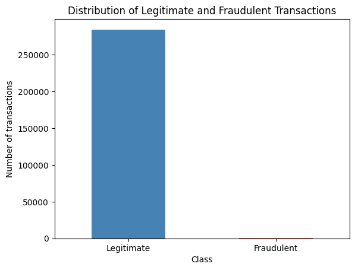
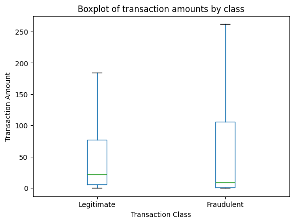

# Credit card fraud detection

## Objective:
To build a simple model that can identify fradulent credit card transactions.

## Dataset:
The dataset was downloaded from Kaggle (https://www.kaggle.com/datasets/mlg-ulb/creditcardfraud/data?select=creditcard.csv). It contains numerical PCA-transformed features, transaction amount, elapsed transaction time, and a fraud label.

- Class 0: legitimate transaction
- Class 1: fraudulent transaction

## Approach
This code will explore the data, train a model using logistic regression, and evaluate its precision, recall, and mistakes.

# Import the required libraries, and load the data:


```python
import pandas as pd
import matplotlib.pyplot as plt
import sklearn
from sklearn import set_config

set_config(display="text")

df = pd.read_csv("creditcard.csv")

df.head()
```


<div>
<style scoped>
    .dataframe tbody tr th:only-of-type {
        vertical-align: middle;
    }

    .dataframe tbody tr th {
        vertical-align: top;
    }

    .dataframe thead th {
        text-align: right;
    }
</style>
<table border="1" class="dataframe">
  <thead>
    <tr style="text-align: right;">
      <th></th>
      <th>Time</th>
      <th>V1</th>
      <th>V2</th>
      <th>V3</th>
      <th>V4</th>
      <th>V5</th>
      <th>V6</th>
      <th>V7</th>
      <th>V8</th>
      <th>V9</th>
      <th>...</th>
      <th>V21</th>
      <th>V22</th>
      <th>V23</th>
      <th>V24</th>
      <th>V25</th>
      <th>V26</th>
      <th>V27</th>
      <th>V28</th>
      <th>Amount</th>
      <th>Class</th>
    </tr>
  </thead>
  <tbody>
    <tr>
      <th>0</th>
      <td>0.0</td>
      <td>-1.359807</td>
      <td>-0.072781</td>
      <td>2.536347</td>
      <td>1.378155</td>
      <td>-0.338321</td>
      <td>0.462388</td>
      <td>0.239599</td>
      <td>0.098698</td>
      <td>0.363787</td>
      <td>...</td>
      <td>-0.018307</td>
      <td>0.277838</td>
      <td>-0.110474</td>
      <td>0.066928</td>
      <td>0.128539</td>
      <td>-0.189115</td>
      <td>0.133558</td>
      <td>-0.021053</td>
      <td>149.62</td>
      <td>0</td>
    </tr>
    <tr>
      <th>1</th>
      <td>0.0</td>
      <td>1.191857</td>
      <td>0.266151</td>
      <td>0.166480</td>
      <td>0.448154</td>
      <td>0.060018</td>
      <td>-0.082361</td>
      <td>-0.078803</td>
      <td>0.085102</td>
      <td>-0.255425</td>
      <td>...</td>
      <td>-0.225775</td>
      <td>-0.638672</td>
      <td>0.101288</td>
      <td>-0.339846</td>
      <td>0.167170</td>
      <td>0.125895</td>
      <td>-0.008983</td>
      <td>0.014724</td>
      <td>2.69</td>
      <td>0</td>
    </tr>
    <tr>
      <th>2</th>
      <td>1.0</td>
      <td>-1.358354</td>
      <td>-1.340163</td>
      <td>1.773209</td>
      <td>0.379780</td>
      <td>-0.503198</td>
      <td>1.800499</td>
      <td>0.791461</td>
      <td>0.247676</td>
      <td>-1.514654</td>
      <td>...</td>
      <td>0.247998</td>
      <td>0.771679</td>
      <td>0.909412</td>
      <td>-0.689281</td>
      <td>-0.327642</td>
      <td>-0.139097</td>
      <td>-0.055353</td>
      <td>-0.059752</td>
      <td>378.66</td>
      <td>0</td>
    </tr>
    <tr>
      <th>3</th>
      <td>1.0</td>
      <td>-0.966272</td>
      <td>-0.185226</td>
      <td>1.792993</td>
      <td>-0.863291</td>
      <td>-0.010309</td>
      <td>1.247203</td>
      <td>0.237609</td>
      <td>0.377436</td>
      <td>-1.387024</td>
      <td>...</td>
      <td>-0.108300</td>
      <td>0.005274</td>
      <td>-0.190321</td>
      <td>-1.175575</td>
      <td>0.647376</td>
      <td>-0.221929</td>
      <td>0.062723</td>
      <td>0.061458</td>
      <td>123.50</td>
      <td>0</td>
    </tr>
    <tr>
      <th>4</th>
      <td>2.0</td>
      <td>-1.158233</td>
      <td>0.877737</td>
      <td>1.548718</td>
      <td>0.403034</td>
      <td>-0.407193</td>
      <td>0.095921</td>
      <td>0.592941</td>
      <td>-0.270533</td>
      <td>0.817739</td>
      <td>...</td>
      <td>-0.009431</td>
      <td>0.798278</td>
      <td>-0.137458</td>
      <td>0.141267</td>
      <td>-0.206010</td>
      <td>0.502292</td>
      <td>0.219422</td>
      <td>0.215153</td>
      <td>69.99</td>
      <td>0</td>
    </tr>
  </tbody>
</table>
<p>5 rows × 31 columns</p>
</div>


# Inspect the data:


```python
# Number of rows and columns in the dataset:
print("Number of rows and columns in the dataset:", df.shape)

# Total number of missing values in the dataset:
print("Total number of missing values in the dataset:", df.isnull().sum().sum())

# Total number of duplicate rows in the dataset:
print("Total number of duplicate rows in the dataset:", df.duplicated().sum())
```

    Number of rows and columns in the dataset: (284807, 31)
    Total number of missing values in the dataset: 0
    Total number of duplicate rows in the dataset: 1081


# Exploratory data analysis (EDA):


```python
# How common is fraud in the dataset?
counts = df['Class'].value_counts().sort_index()


summary = pd.DataFrame({'Class': counts.index, 
                        'Count': counts.values,
                        'Percentage (%)': (counts.values / len(df)) * 100
})


summary.index = ["Legitimate", "Fraudulent"]

summary.round(3)

```


<div>
<style scoped>
    .dataframe tbody tr th:only-of-type {
        vertical-align: middle;
    }

    .dataframe tbody tr th {
        vertical-align: top;
    }

    .dataframe thead th {
        text-align: right;
    }
</style>
<table border="1" class="dataframe">
  <thead>
    <tr style="text-align: right;">
      <th></th>
      <th>Class</th>
      <th>Count</th>
      <th>Percentage (%)</th>
    </tr>
  </thead>
  <tbody>
    <tr>
      <th>Legitimate</th>
      <td>0</td>
      <td>284315</td>
      <td>99.827</td>
    </tr>
    <tr>
      <th>Fraudulent</th>
      <td>1</td>
      <td>492</td>
      <td>0.173</td>
    </tr>
  </tbody>
</table>
</div>


# Plot the counts:


```python
counts.plot.bar(color=["steelblue", "tomato"])

plt.xticks([0, 1], ["Legitimate", "Fraudulent"], rotation=0)
plt.ylabel("Number of transactions")
plt.title("Distribution of Legitimate and Fraudulent Transactions")
plt.show()
```


    

    


### Key Observation:
Fraudulent transactions represent only 0.17% of the total transactions in our dataset. Therefore, a high overall accuracy alone wouldn't demonstrate that the model can detect fradulent transactions.

# How do transaction amounts differ?


```python
df.groupby("Class")["Amount"].agg(["count", "mean", "std", "median", "min", "max"]).round(2)
```


<div>
<style scoped>
    .dataframe tbody tr th:only-of-type {
        vertical-align: middle;
    }

    .dataframe tbody tr th {
        vertical-align: top;
    }

    .dataframe thead th {
        text-align: right;
    }
</style>
<table border="1" class="dataframe">
  <thead>
    <tr style="text-align: right;">
      <th></th>
      <th>count</th>
      <th>mean</th>
      <th>std</th>
      <th>median</th>
      <th>min</th>
      <th>max</th>
    </tr>
    <tr>
      <th>Class</th>
      <th></th>
      <th></th>
      <th></th>
      <th></th>
      <th></th>
      <th></th>
    </tr>
  </thead>
  <tbody>
    <tr>
      <th>0</th>
      <td>284315</td>
      <td>88.29</td>
      <td>250.11</td>
      <td>22.00</td>
      <td>0.0</td>
      <td>25691.16</td>
    </tr>
    <tr>
      <th>1</th>
      <td>492</td>
      <td>122.21</td>
      <td>256.68</td>
      <td>9.25</td>
      <td>0.0</td>
      <td>2125.87</td>
    </tr>
  </tbody>
</table>
</div>


```python
df.boxplot(column="Amount", by="Class", grid=False, showfliers=False)

plt.xticks([1, 2], ["Legitimate", "Fraudulent"], rotation=0)
plt.xlabel("Transaction Class")
plt.ylabel("Transaction Amount")
plt.title("Boxplot of transaction amounts by class")
plt.suptitle("")
plt.show()
```


    

    


### NOTE: For improved readability, extreme values have been hidden in the above figure, not removed from the dataset.

# Train a model:


```python
# Import the necessary libraries for model training and evaluation:
from sklearn.pipeline import make_pipeline
from sklearn.preprocessing import StandardScaler
from sklearn.linear_model import LogisticRegression


df = df.sort_values("Time").reset_index(drop=True)

# Keep transactions with the same timestamp together:
cutoff = df["Time"].iloc[int(len(df) * 0.8)]

# Split the dataset into training and testing sets based on the cutoff timestamp:
train = df[df["Time"] < cutoff]
test = df[df["Time"] >= cutoff]

x_train = train.drop(columns="Class")
y_train = train["Class"]

x_test = test.drop(columns="Class")
y_test = test["Class"]

# Create a pipeline that standardizes the features and trains a logistic regression model with balanced class weights:
model = make_pipeline(
    StandardScaler(),
    LogisticRegression(class_weight="balanced", max_iter=2000)
)

model.fit(x_train, y_train)

```


    Pipeline(steps=[('standardscaler', StandardScaler()),
                    ('logisticregression',
                     LogisticRegression(class_weight='balanced', max_iter=2000))])


```python
print("Training transactions:", len(train))
print("Testing transactions:", len(test))

print("Training fraudulent transactions:", y_train.sum())
print("Testing fraudulent transactions:", y_test.sum())
```

    Training transactions: 227845
    Testing transactions: 56962
    Training fraudulent transactions: 417
    Testing fraudulent transactions: 75


# Evaluate the model:


```python
# Check the precision, recall, and F1-score (mistakes) of the model on the test set:
from sklearn.metrics import classification_report, ConfusionMatrixDisplay

predictions = model.predict(x_test)

print(classification_report(
    y_test, 
    predictions, 
    target_names = ["Legitimate", "Fraudulent"],
    digits = 3,
    zero_division = 0
))
```

                  precision    recall  f1-score   support
    
      Legitimate      1.000     0.985     0.992     56887
      Fraudulent      0.071     0.893     0.131        75
    
        accuracy                          0.984     56962
       macro avg      0.535     0.939     0.562     56962
    weighted avg      0.999     0.984     0.991     56962
    


# Plot the confusion matrix:


```python
ConfusionMatrixDisplay.from_predictions(
    y_test, 
    predictions, 
    display_labels = ["Legitimate", "Fraudulent"],
    cmap = "Blues",
    values_format = "d"
)

plt.title("Confusion Matrix")
plt.show()
```


    

    


### Model evaluation:
The model detected 67 of the 75 fraudulent transactions in the test set,
achieving fraud recall of 89.3%. It missed 8 fraudulent transactions.

However, fraud precision was only 7.1%. This means that approximately
7 out of every 100 transactions flagged as fraud were actually fraudulent;
the remaining 93 were legitimate transactions.

The model therefore catches most fraud cases, but generates many false
alarms. This could create a substantial workload if every flagged
transaction required manual review.

Although overall accuracy was 98.4%, accuracy alone is misleading here
because the vast majority of transactions are legitimate. Precision and
recall provide a clearer picture of the model's fraud-detection performance.

Overall, the model prioritizes catching fraud over keeping false alerts low.

# Precision-recall curve:


```python
from sklearn.metrics import(
    average_precision_score,
    PrecisionRecallDisplay
)

scores = model.predict_proba(x_test)[:, 1]

print(
    "Average precision:",
    round(average_precision_score(y_test, scores), 3)
)

PrecisionRecallDisplay.from_predictions(y_test, scores)
plt.title("Precision–recall curve")
plt.show()
```

    Average precision: 0.762


    

    


## Key findings:
- Fraud accounted for approximately 0.132% of transactions in the test set (75 out of 56,962 transactions).

- The model detected 67 of 75 fraud cases in the test period, and missed 8.

- Fraud precision was 7.1% and fraud recall was 89.3%.

- The model incorrectly flagged 880 legitimate transactions.


## Conclusion
The model detected most fraudulent transactions, but generated many false alarms. It identified approximately 9 out of every 10 fraud cases, yet only about 7 out of every 100 transactions flagged as fraud were
actually fraudulent.

These results show a trade-off: the model catches a large proportion of fraud, but its alerts would require substantial review. High recall alone does not make the model suitable for automatically blocking transactions.


## Limitations
- The PCA-transformed features do not have clear business meanings, limiting explanations of why individual transactions were flagged.

- Results reflect this dataset and evaluation period, not necessarily future real-world transactions.

- False alerts and missed fraudulent transactions have different consequences, but this project doesn't estimate their financial or operational costs.

- The test set contained only 75 fraud cases, so a few additional detections or misses would noticeably change the reported recall.

- This is a learning project, not a production fraud-detection system.
